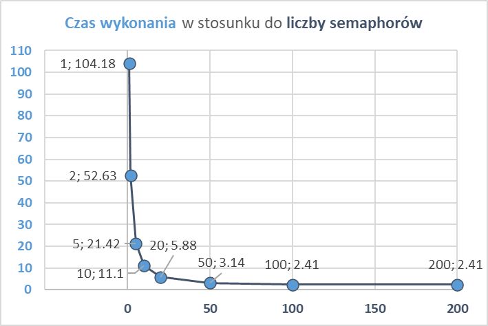
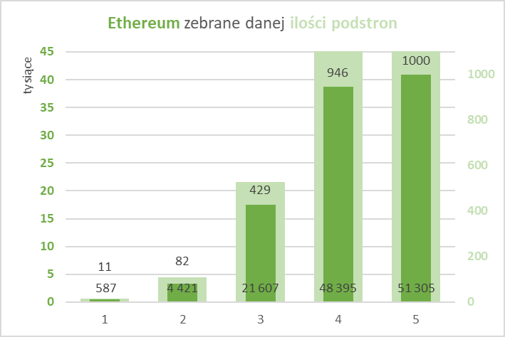

# Automatyczne pozyskiwanie danych - Zbieracz Ethereum

## Serwer Ethereum
Aplikacja webowa oparta na Flask'u udostępnia graf w postaci podstron. Większość z nich zawiera zaszyte w kodzie HTML informacje:
- numerze / identyfikator podstrony,
- ilości Ethereum (ETH) możliwą do zebrania,
- listę linków do kolejnych podstron

Niektóre podstrony wymagają hasła, w ich przypadku hasło znajdziemy w nagłówku x-password i odsyłamy je uzyskując dostęp.

## Cel projektu
Zastosowaniem projektu jest automatyczne przejście po wszystkich dostępnych podstronach *serwisu Ethereum* i zebranie całego Ethereum rozsianego na podstronach.

Wyniki działania programu zapisujemy do pliku `.json` w formacie:
```json
{
  "suma": <suma>
  "wierzchołki": [
    {
      "node": <numer>,
      "ethereum": <kwota>
    },
    ...
  ]
}
```

### BFS – przeszukiwanie grafu wszerz
W projekcie wykorzystaliśmy algorytm BFS (Breadth-First Search), oparty o:
- kolejkę FIFO (First-In-First-Out) do zapamiętania wierzchołków do odwiedzenia,
- zbiór `visited` przechowujący już odwiedzone podstrony.

Etapy algorytmu:
1. Dodaje pierwszy wierzchołek do kolejki,
2. Dla każdego wierzchołka w kolejce:
    - pobiera i przetwarza wierzchołek (o ile jeszcze nie był odwiedzony)
    - dodaje ten wierzchołek do zbioru odwiedzonych
    - dodaje kolejne nieodwiedzone sąsiednie wierzchołki do kolejki.


## Opis funkcji - spider.py (wersja synchroniczna)
### *get_first_node()*
Pobiera link do pierwszej podstrony ze strony głównej *serwera Ethereum*. Wykonuje żądanie HTTP GET, parsuje HTML przy użyciu BeautifulSoup, wyszukuje element `<a>` z linkiem i go zwraca. Obsługuje wyjątki w przypadku problemów z połączeniem (np. użytkownik zapomniał włączyć serwera).

### *get_node(href: str)*
Dla danego linku do podstrony wykonuje zapytanie GET przy pomocy requests i parsuje HTML przy użyciu BeautifulSoup:
- pobiera zawartość HTML
- parsuje numer wierzchołka (z nagłówka `<h2>`)
- wyciąga ilość Ethereum (z paragrafu `<p>`)
- wyszukuje linki do kolejnych podstron (elementy `<a>`)

W przypadku braku dostępu rozpoznaje komunikat "Brak dostępu" w nagłówku `<h1>` oraz:
- pobiera hasło z nagłówka pliku `x-password`
- wysyła zapytanie POST na `/validate_password/{node_href}`
- ponawia pierwotne zapytanie GET i wyciąga poprawne informację

Jeżeli również nie znajdzie hasła to odczytuje tylko numer wierzchołka, zbiera 0 Ethereum i nie zwraca sąsiadów.

### *spider_bfs(start_href: str)*
Synchroniczna implementacja algorytmu BFS. Przetwarza kolejne podstrony, dodając uzyskane dane z podstron do wyników.

Monitoruje postępu przeszukiwania wraz z każdym kolejnym wierzchołkiem, aktualizując komunikat o:
- liczbie odwiedzonych podstron,
- liczbie zebranego Ethereum,
- czasie wykonywania programu.

### *save_json(data: list[dict[int, int]], output_name: str='ethereum.json')*
Zapisuje dane zebrane przez pająka do pliku `.json`. Sumuje Ethereum i zapisuje je wraz z wynikami w strukturze zgodnej z oczekiwanym formatem.

### *main()*
Uruchamia cały proces:
- pobiera pierwszy link,
- uruchamia pająka,
- zapisuje wyniki do pliku .json.

## Opis funkcji - async_spider.py (wersja asynchroniczna)
### *get_first_node()*
Działa analogicznie jak wersja synchroniczna – pobiera i parsuje pierwszy link ze strony głównej.

### *get_node(session: ClientSession, href: str)*
Działa podobnie do wersji synchronicznej. Wykonuje wszystkie zapytania w ramach sesji i wykorzystuje semafory do ograniczenia ilości maksymalnie wykonywanych zadań.

### *spider_bfs_async(start_href: str, max_depth: int = None)*
Asynchronicznie przeszukuje podstrony serwisu:
- używa globalnej kolejki i zbioru, aby poszczególne zadania mogły bezpośrednio dodawać swoje wyniki,
- wykonuje równoległe zapytania, przetwarzając wiele podstron jednocześnie,
- ogranicza przeszukiwanie zgodnie z: `max_depth`,
- szybszy czas wykonywania względem wersji synchronicznej.

Praca asynchroniczna polega na wykonywaniu innych działań, jeżeli czekamy na ukończenie operacji I/O.

### *progress_report()*
W osobnym asynchronicznym wątku co 100 ms drukuje pasek postępu:
- liczba odwiedzonych podstron,
- liczba zebranego Ethereum,
- czas wykonywania programu.

### *save_json(data: list[dict[int, int]], output_name: str='ethereum.json')*
Działa identycznie jak w wersji synchronicznej.

### *main()*
Uruchamia cały proces:
- pobiera pierwszy link,
- startuje pasek postępu i pająka (spider_bfs_async),
- zapisuje wyniki do pliku .json.

## Porównanie działania: synchroniczny vs asynchroniczny
Synchroniczny pająk odwiedza wszystkie 1000 podstron po kolei w około 104 sekund, zbierając 51305 ETH.

Asynchroniczny pająk rozdziela się i wędruje jednocześnie po wszystkich dostępnych ścieżkach. Również przechodzi przez wszystkie podstrony i gromadzi 51305 ETH. Różnica pojawia się w prędkości działania, dla ograniczonej liczby semaforów do jednego, uzyskuje czas pracy synchronicznej. Jednak szybkość przeszukiwania wzrasta dwukrotnie wraz z dwukrotnym zwiększeniem liczby semaforów za każdym razem do około 50 równoległych zadań, po czym dalszy wzrost jest marginalny. 
semafory | czas
---|---
1	|104.18s
2	|52.63s
5	|21.42s
10|	11.1s
20|	5.88s
50|	3.14s
100|	2.41s
200|	2.41s



Asynchroniczny pająk pozwala także ograniczyć liczbę przeszukiwanych wszerz podstron, aby odwiedzić wszystkie podstrony wymagane są ścieżki długości pięć.


głębokość | strony | ethereum
---|---|---
1	| 11	|587
2	| 82	|4421
3	| 429	|21607
4	| 946	|48395
5	| 1000|	51305



## Uruchamianie aplikacji
W celu uruchomienia programów, należy:

1. Zainstalować wymagane biblioteki, poleceniem: pip install bs4, requests, aiohttp
2. Upewnić się, że serwer Ethereum jest uruchomiony, jeżeli nie to posiadając *Docker Desktop* w katalogu *ethereum* z dołączonymi plikami: *Dockerfile*, *requirements.txt* wykonujemy polecenia:
    ```
    docker build -t etherium .
    docker run --name ether -p 5000:5000 etherium
    ```

3. Uruchamiamy żądaną wersje poleceniem:
  - synchroniczna:
    ```
    py spider.py
    ```
  - asynchroniczna:
    ```
    py async_spider.py
    ```
